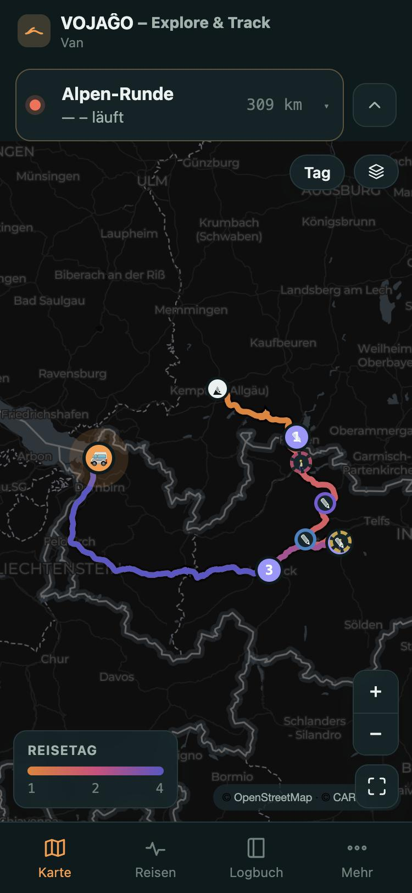
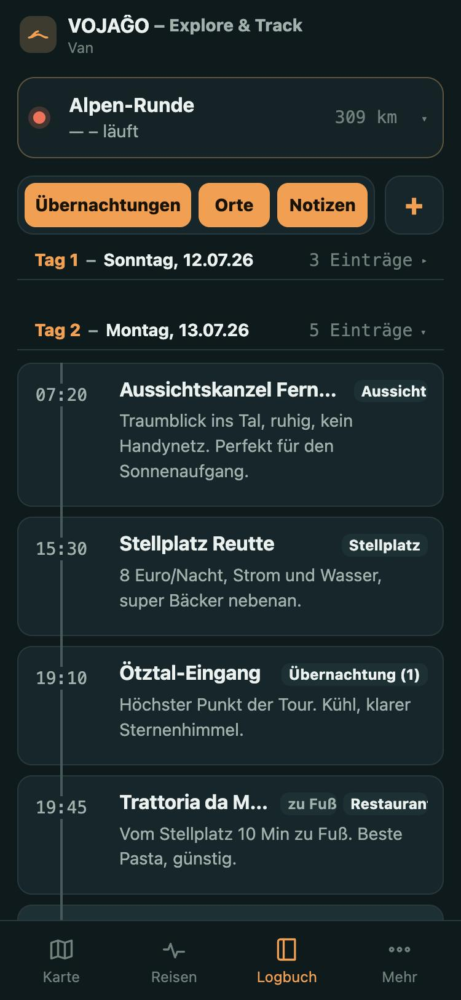
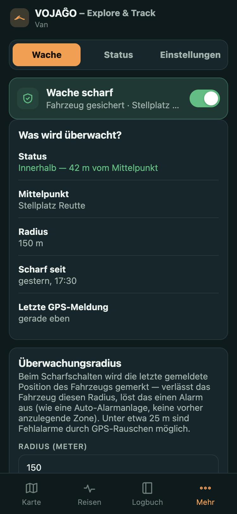

# VOJAĜO — Explore & Track

A self-hosted GPS tracker and travel companion for a camper van. It turns the
position data of the **router already on board** (Teltonika **RUTX50** with
GPS) into a logbook of drives, stops, overnight stays and trips — no
subscription SIM, no third-party tracking service.

## What it does

- **Map** with route colouring by speed, elevation, period or km from start;
  zoom/pan and layer toggles (overnight stays, places, km markers).
- **Automatic logbook**: drives, short stops and overnight stays are detected
  on the server from the raw positions — even when the app is closed. Places
  get a name (reverse geocoding) and the weather at the time of the visit.
- **Trips**: named time spans over the logbook that bundle drives, stays,
  places, notes and photos, with statistics, elevation and speed profiles.
- **Your places**: categories, photos, notes, ratings, show-on-map.
- **Guard** (anti-theft): arm the vehicle at its last reported position, get an
  alarm and a web push notification when it leaves the monitored radius.
- **Sharing**: read-only link without login, scope selectable (map, or map plus
  logbook), one trip or all, with expiry and revocation.
- **Installable PWA**, works offline, demo mode without an account.

## Screenshots

Demo mode with fictional data (the app UI is currently German). The demo
routes follow real roads; the route geometry is © OpenStreetMap contributors
(ODbL), computed with OSRM by `scripts/gen-demo-roads.mjs`.

<table>
  <tr>
    <td align="center"><br><sub>Map: route coloured by trip day</sub></td>
    <td align="center"><br><sub>Logbook: days, places, notes</sub></td>
    <td align="center"><br><sub>Guard: status, anchor, radius</sub></td>
  </tr>
</table>

## Core concept: logbook → drives → trips

- **Logbook** (always on): gapless record of every movement, received by the
  own `ingest` service.
- **Drive**: one continuous movement, segmented on the server from the raw
  positions (`segmentDrives` in `api/lib.js`).
- **Stop / overnight stay**: a stand of at least 20 minutes becomes a *stop*;
  a stand of at least 5 hours with at least 2 hours inside the night window
  (22:00–06:00) becomes an *overnight stay*. Stays are evaluated even while the
  vehicle is still standing and the router has gone quiet, are clipped at the
  end of a trip, and outside a trip (everyday life) no overnight stays are
  created. Long reporting gaps with the vehicle at the same spot count as
  standing.
- **Trip**: a named time span over the logbook, automatic suggestion or manual,
  non-overlapping.
- **Everyday drives**: drives outside any trip (shopping, workshop) stay in
  the logbook but not in the trip list.

Details are in [`docs/concept.md`](docs/concept.md). UX and working
guidelines for future changes are in
[`docs/arbeitsgrundlage.md`](docs/arbeitsgrundlage.md).

## Guard

- Arming stores the vehicle's last reported position as the single anchor
  point; the radius is configurable (default 50 m; below about 25 m GPS noise
  can cause false alarms).
- A change inside/outside counts only after two consecutive positions in the
  new state; after a few minutes of silence the state of the last position is
  confirmed (so a return home is reported even if the router stops reporting).
- Alarm log, push notification (Web Push), an info card with status, distance,
  radius and age of the last GPS report, and the monitored circle on the map.
- Currently only the geofence alarm is implemented. Vibration, on-board voltage
  and power-loss alarms need data the router does not report.

## Architecture

```
RUTX50 (GPS)  ──5027──▶  ingest container (tracker-backend/)
                              Teltonika (TCP) + OsmAnd (HTTP)
                              │
                              ▼
                   shared Docker volume
                   SQLite (WAL) — raw_packets, positions, …
                              ▲
                              │  reads/writes via D1/R2 shims
                              │
                    app container (app-backend/)
                    web app + /api/* (api/router.js)
                              │
                              ▼
                  Cloudflare Tunnel (TLS termination only)
                              │
                              ▼
                   your-domain.example → browser / PWA
```

- **`ingest`** ([`tracker-backend/`](tracker-backend/)) is the data engine: it
  receives raw positions from the RUTX50 (Teltonika Codec 8/8E over TCP) and
  from secondary devices (OsmAnd protocol over HTTP, e.g. phone apps or the
  ESP32 logger), stores them permanently, evaluates the guard on every new
  position and detects stops and overnight stays (event-driven, plus timers
  for stands that are still running).
- **`app`** ([`app-backend/`](app-backend/)) is the web app plus its own API.
  It runs the same `api/router.js` / `api/lib.js` as the earlier Cloudflare
  deployment, through thin shims (`d1-shim.js` on `better-sqlite3`,
  `r2-shim.js` on the file system) instead of D1/R2.
- **One shared Docker volume** with a single SQLite file connects both
  containers — no internal RPC/HTTP between them. Two processes on purpose:
  separate blast radius, separate deploys, and the unauthenticated network
  inputs (Teltonika/OsmAnd) stay apart from sessions and photos.
- **Cloudflare Tunnel** only terminates TLS for the public domain (optional; any reverse proxy works). The
  app's own authentication (password hashing, HttpOnly+Secure+SameSite cookie,
  login rate limiting) is the protection layer.
- **PWA**: the front end (installable, offline-capable), served by the `app`
  container from `public/`.

Deployment is `docker compose up -d --build` with
[`docker-compose.yml`](docker-compose.yml) at the repository root (e.g. via
Portainer on the target server). Details in
[`app-backend/README.md`](app-backend/README.md) and
[`tracker-backend/README.md`](tracker-backend/README.md). Some directories from
earlier iterations (Cloudflare Pages/Workers, VPN setup) remain in the
repository for reference and are inactive.

## Status

- [x] Installable web app (PWA): app shell, manifest, service worker, real map,
  live and demo mode
- [x] Own tracking back end ([`tracker-backend/`](tracker-backend/)): Teltonika
  Codec 8/8E (TCP) and OsmAnd (HTTP), both verified with real hardware
- [x] App back end ([`app-backend/`](app-backend/)): auth, trips, places,
  notes, photos, categories, vehicles (with cross-device sync)
- [x] Server-side detection of drives, stops and overnight stays from the own
  `positions` table
- [x] Guard with a single anchor point, debounced alarms, web push and info card
- [x] Two-container stack in production with real trips on a real vehicle
- [x] CI: tests, build, production audit and full toolchain audit on GitHub
  Actions
- [x] API/D1 integration tests for auth, trips, places, notes, settings,
  categories and vehicles
- [ ] Further guard alarms (vibration, voltage, power loss) — need additional
  hardware or data

## Development

Requirement: **Node 22** (the project ships an `.nvmrc`). The current Wrangler
version no longer starts with Node 18.

```bash
npm ci
npm test
npm run build
npm run test:smoke
```

`npm test` covers pure logic tests and API/D1 integration tests. The local D1
test adapter loads `api/schema.sql` into an in-memory SQLite database and
calls the real API router.

`npm run test:smoke` builds the app and opens it in a browser with Playwright.
It clicks through the main areas (map, trips, logbook, more) and fails on
browser console errors.

## Versioning

The version comes from `package.json` (`1.0.0` is shown as "1.0"). Every build also
carries a build number — the number of commits — and the short commit hash, shown
with the build date in the app (More → Status → App), e.g. "Build 142 · a1b2c3d".
Docker builds have no `.git`, so pass `BUILD_NUMBER` and `BUILD_COMMIT` as build
arguments (like `CARTO_API_KEY`); without them the app shows a content hash instead.

## Map tiles

The map uses CARTO basemap tiles, which need a free API key
([carto.com/basemaps/apikey](https://carto.com/basemaps/apikey/)). The key is
not stored in the repository; set it when building:

```bash
CARTO_API_KEY=your-key npm run build
```

Without a key the map shows "API KEY REQUIRED" watermarks. In the Docker stack
the key is passed as a build argument: set `CARTO_API_KEY` (and optionally
`APP_URL`) as stack environment variables or in a `.env` next to
`docker-compose.yml`.

## Running locally

```bash
npm run build
npm run dev
```

This builds the plain PWA and serves it through `wrangler pages dev` (static
preview without its own API — demo mode). Alternatively, serve the contents of
`public/` after the build with any static web server.

For the full local environment including the own API and database (equivalent
to the production self-hosting setup) see
[`app-backend/README.md`](app-backend/README.md) and
[`tracker-backend/README.md`](tracker-backend/README.md).

## Working locally with real data

The repository is public, but you can work with real data locally and keep it
out of git: see [`docs/local-setup.md`](docs/local-setup.md)
(`npm run setup-local` activates a git guard and creates the git-ignored
`local/` folder).

## Quality and security

The CI workflow runs on pushes to `main` and on pull requests:

- `npm ci`
- `npm test`
- `npm run build`
- `npm run test:smoke`
- `npm audit --omit=dev`
- `npm audit --audit-level=high`

This checks both the shipped dependencies and the dev/deploy toolchain.

## License

[MIT](LICENSE)
